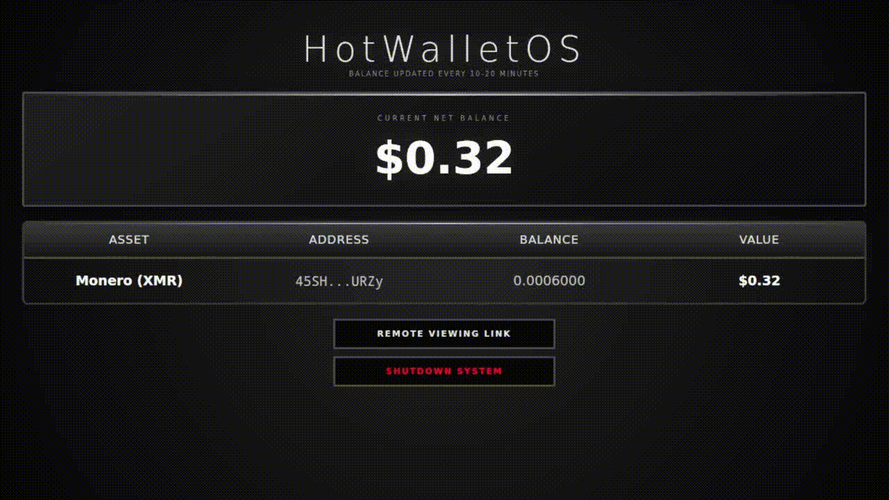

# **MonerOS**
**The air-gapped crypto distro for Monero and Bitcoin**

Designed to protect the digital assets of even the most inexperienced users, MonerOS makes it easy to hold these assets securely and privately. Exchanges get hacked regularly and those in charge of them sometimes use your crypto as if they own it. If you don't own the keys, you don't own the crypto. Traditional cold wallets have also had some very troubling issues such as closed-source code, supply chain attacks and customer data leaks. Not to mention these devices are often expensive. MonerOS was created to turn your computer into an air gapped hardware wallet by simply using two flash drives. From wallet creation to transaction broadcasting, the internet never sees your private keys. The system consists of two specialized distros: HotWalletOS and ColdWalletOS. Because these run on external drives that you boot from, your normal operating system can't monitor them, keylog them, or lock them out. When you power down and unplug the drives, your computer has no record of what took place in this timeframe.

**HotWalletOS** monitors your balance, creates and submits unsigned transacions and now allows atomic swaps between Monero and Bitcoin.

**ColdWalletOS** is the air-gapped portion of the system that can create wallets and sign the unsigned transactions generated by HotWalletOS. The air-gap is enforced at the build level: we didn't just disable wireless features—we completely purged network drivers, wireless firmware blobs, and package managers (apt/dpkg) directly from the image.

Your data on both systems is encrypted using Luks2. ColdWalletOS contains a Luks2 encrypted partition to store your private keys. HotWalletOS uses a Luks2 encrypted file container called a "Sallyport" to store a watch-only version of your wallets and to hold signed and unsigned transactions. You create an unsigned transaction while booted from HotWalletOS and it saves it in the encypted Sallyport. You then shutdown and boot from ColdWalletOS with the HotWalletOS drive plugged in. ColdWalletOS decrypts the Sallyport, signs the unsigned transaction (with your approval). It then replaces the unsigned transactions with the signed ones and locks it back up. You then boot HotWalletOS by itself, unlock it and submit the new signed transactions. It is a 100% open-source digital vault where the community can verify every line of code, ensuring there are no backdoors to your assets.

---

## Demonstration Video (3x speed)
> **Note:** The only way to capture this process is via a capture card, which significantly reduces screen resolution. Actual system clarity is much better.

There are three things happening in this video:

1. Creating an unsigned transaction with HotWalletOS and shutting the system down.
2. Booting ColdWalletOS, signing the unsigned transaction, and shutting the system down.
3. Booting HotWalletOS again to submit the signed transaction.



---


---
## **Hardware Requirements**

**MonerOS** is designed to be lightweight and efficient. It can be deployed on most amd64 (64-bit) hardware, from older laptops to modern workstations. Running your own Monero Node (Self-Sync) is best for maximum privacy but requires significantly better hardware than using Remote Nodes. Self-Sync Nodes also take days to be ready for use, whereas Remote Nodes are ready almost immediately.

### **1. ColdWalletOS (The Vault)**
* **CPU:** 2+ Cores
* **RAM:** 1GB+
* **Storage Space:** 4GB+
* **Storage Media:** Flash Drive, MicroSD, HDD, or SSD

### **2. HotWalletOS (The Gateway)**
* **CPU:** 2+ Cores
* **RAM:** 8GB+
* **Storage Space:** 4GB+
* **Storage Media:** SSD Recommended

The hardware requirements for HotWalletOS vary depending on how you want to run it. If privacy is of the utmost importance to you, an SSD of at least 250GB is required. For most users, any flash drive of at least 32GB is sufficient. While only 4GB is required to run HotWalletOS, atomic swaps require a drive of at least 32GB. A Solid State Drive (SSD) is strictly required for running your own Monero Node. Traditional Hard Drives (HDDs) cannot handle the I/O demands of blockchain synchronization.

---

## **Monero Risks by Node Type**
<table>
  <tr>
    <th style="background-color: #000000; color: #ffffff; padding: 8px; border: 1px solid #ccc;">Data Point / Metadata Risk</th>
    <th style="background-color: #000000; color: #ffffff; padding: 8px; border: 1px solid #ccc;">Clearnet Node<br>(IP or .com address)</th>
    <th style="background-color: #000000; color: #ffffff; padding: 8px; border: 1px solid #ccc;">Tor Node<br>(.onion address)</th>
    <th style="background-color: #000000; color: #ffffff; padding: 8px; border: 1px solid #ccc;">Self-Sync<br>(Local node)</th>
  </tr>
  <tr>
    <td style="background-color: #FFFF00; color: #000000; padding: 8px; border: 1px solid #ccc;"><b>Your Real IP Address</b></td>
    <td style="background-color: #EE0000; color: #000000; padding: 8px; border: 1px solid #ccc;">Exposed</td>
    <td style="background-color: #47D459; color: #000000; padding: 8px; border: 1px solid #ccc;">Hidden</td>
    <td style="background-color: #47D459; color: #000000; padding: 8px; border: 1px solid #ccc;">Hidden</td>
  </tr>
  <tr>
    <td style="background-color: #FFFFFF; color: #000000; padding: 8px; border: 1px solid #ccc;"><b>View Key & Private Keys</b></td>
    <td style="background-color: #47D459; color: #000000; padding: 8px; border: 1px solid #ccc;">Hidden</td>
    <td style="background-color: #47D459; color: #000000; padding: 8px; border: 1px solid #ccc;">Hidden</td>
    <td style="background-color: #47D459; color: #000000; padding: 8px; border: 1px solid #ccc;">Hidden</td>
  </tr>
  <tr>
    <td style="background-color: #FFFFFF; color: #000000; padding: 8px; border: 1px solid #ccc;"><b>Imported Key Image Database</b></td>
    <td style="background-color: #47D459; color: #000000; padding: 8px; border: 1px solid #ccc;">Hidden</td>
    <td style="background-color: #47D459; color: #000000; padding: 8px; border: 1px solid #ccc;">Hidden</td>
    <td style="background-color: #47D459; color: #000000; padding: 8px; border: 1px solid #ccc;">Hidden</td>
  </tr>
  <tr>
    <td style="background-color: #FFFFFF; color: #000000; padding: 8px; border: 1px solid #ccc;"><b>Balances & Tx Amounts</b></td>
    <td style="background-color: #47D459; color: #000000; padding: 8px; border: 1px solid #ccc;">Hidden</td>
    <td style="background-color: #47D459; color: #000000; padding: 8px; border: 1px solid #ccc;">Hidden</td>
    <td style="background-color: #47D459; color: #000000; padding: 8px; border: 1px solid #ccc;">Hidden</td>
  </tr>
  <tr>
    <td style="background-color: #FFFFFF; color: #000000; padding: 8px; border: 1px solid #ccc;"><b>Sender & Receiver Addresses</b></td>
    <td style="background-color: #47D459; color: #000000; padding: 8px; border: 1px solid #ccc;">Hidden</td>
    <td style="background-color: #47D459; color: #000000; padding: 8px; border: 1px solid #ccc;">Hidden</td>
    <td style="background-color: #47D459; color: #000000; padding: 8px; border: 1px solid #ccc;">Hidden</td>
  </tr>
  <tr>
    <td style="background-color: #FFFF00; color: #000000; padding: 8px; border: 1px solid #ccc;"><b>Wallet Age / Restore Height</b></td>
    <td style="background-color: #EE0000; color: #000000; padding: 8px; border: 1px solid #ccc;">Exposed</td>
    <td style="background-color: #EE0000; color: #000000; padding: 8px; border: 1px solid #ccc;">Exposed</td>
    <td style="background-color: #47D459; color: #000000; padding: 8px; border: 1px solid #ccc;">Hidden</td>
  </tr>
  <tr>
    <td style="background-color: #FFFF00; color: #000000; padding: 8px; border: 1px solid #ccc;"><b>Sync Schedule & Uptime</b></td>
    <td style="background-color: #EE0000; color: #000000; padding: 8px; border: 1px solid #ccc;">Exposed</td>
    <td style="background-color: #EE0000; color: #000000; padding: 8px; border: 1px solid #ccc;">Exposed</td>
    <td style="background-color: #47D459; color: #000000; padding: 8px; border: 1px solid #ccc;">Hidden</td>
  </tr>
  <tr>
    <td style="background-color: #FFFF00; color: #000000; padding: 8px; border: 1px solid #ccc;"><b>Transaction Origin (IP Linkage)</b></td>
    <td style="background-color: #EE0000; color: #000000; padding: 8px; border: 1px solid #ccc;">Exposed</td>
    <td style="background-color: #47D459; color: #000000; padding: 8px; border: 1px solid #ccc;">Hidden</td>
    <td style="background-color: #47D459; color: #000000; padding: 8px; border: 1px solid #ccc;">Hidden</td>
  </tr>
  <tr>
    <td style="background-color: #FFFF00; color: #000000; padding: 8px; border: 1px solid #ccc;"><b>Block Withholding Risk (Eclipse)</b></td>
    <td style="background-color: #EE0000; color: #000000; padding: 8px; border: 1px solid #ccc;">Vulnerable</td>
    <td style="background-color: #EE0000; color: #000000; padding: 8px; border: 1px solid #ccc;">Vulnerable</td>
    <td style="background-color: #47D459; color: #000000; padding: 8px; border: 1px solid #ccc;">None</td>
  </tr>
  <tr>
    <td style="background-color: #FFFF00; color: #000000; padding: 8px; border: 1px solid #ccc;"><b>Transaction Censorship Risk</b></td>
    <td style="background-color: #EE0000; color: #000000; padding: 8px; border: 1px solid #ccc;">Vulnerable</td>
    <td style="background-color: #EE0000; color: #000000; padding: 8px; border: 1px solid #ccc;">Vulnerable</td>
    <td style="background-color: #47D459; color: #000000; padding: 8px; border: 1px solid #ccc;">None</td>
  </tr>
</table>

---

## Downloading or Building the Software

From a security standpoint, building the software yourself is best, but you can download a ready-built version at https://sourceforge.net/projects/moneros/files/.

**Building the Software:**
```bash
# Install Dependencies
sudo apt update && sudo apt install -y \
    git \
    live-build \
    debootstrap \
    xorriso \
    grub-efi-ia32-bin \
    grub-efi-amd64-bin \
    grub-pc-bin \
    mtools \
    dosfstools \
    exfatprogs \
    squashfs-tools \
    imagemagick \
    isolinux \
    syslinux \
    syslinux-common
    
# Clone Repository
git clone https://github.com/MonerOS-dev/MonerOS.git

# Get updated monero binary files (optional)
bash $HOME/MonerOS/get_binaries.sh

# Compile HotWalletOS
bash $HOME/MonerOS/build-HotWalletOS.sh
# Compiled file will be at: $HOME/MonerOS_Output/HotWalletOS.img

# Compile ColdWalletOS
bash $HOME/MonerOS/build-ColdWalletOS.sh
# Compiled file will be at: $HOME/MonerOS_Output/ColdWalletOS.img

# Compile UpdateOS (optional)
bash $HOME/MonerOS/build-UpdateOS.sh
# Compiled file will be at: $HOME/MonerOS_Output/UpdateOS.img

# --- To save space, it's recommended to clean the build directory after after each compilation ---

# Clean HotWalletOS
cd $HOME/MonerOS/HotWalletOS/ && sudo lb clean --purge && cd

# Clean ColdWalletOS
cd $HOME/MonerOS/ColdWalletOS/ && sudo lb clean --purge && cd

# Clean UpdateOS
cd $HOME/MonerOS/UpdateOS/ && sudo lb clean --purge && cd
```

---

## **How the air-gap works**
ColdWalletOS has zero Wi-Fi, Bluetooth, or internet connection, making remote hacking architecturally impossible. We didn't just turn off wireless features; we permanently purged network drivers, wireless firmware blobs, and hardware modules at the build level. On both HotWalletOS and ColdWalletOS, we also stripped out package managers (apt, dpkg, pip) to entirely eliminate software installation vectors and prevent local payload drops.

---

## **Atomic Swaps**
Atomic Swaps are supported via BasicSwap. If enabled, a button will be visible on your the main page. You must move funds into a basicswap address to make the swap and then you can move them to a MonerOS air-gapped address after the swap is complete. BasicSwap addresses are not air-gapped. For maximum privacy, you should regularly change BasicSwap addresses, especially on every swap.

---

## Installation, User and Update Manuals
* **[Read the Installation Manual](https://github.com/MonerOS-dev/MonerOS/blob/main/Installation_Manual.pdf)**
* **[Read the User Manual](https://github.com/MonerOS-dev/MonerOS/blob/main/User_Manual.pdf)**
* **[Read the Update Manual](https://github.com/MonerOS-dev/MonerOS/blob/main/Update_Manual.pdf)**

---

## **Important: Beta Phase Notice**

**MonerOS is currently in Beta.** While we strive for maximum security, please be aware that the software is still under active development.

* **Community Contribution:** Real-world testing is vital to the evolution of this project. By using MonerOS now, you are helping us identify edge cases and harden the system for the entire community.

---

## **Coming Soon**

- arm64 support (including rpi4 & rpi5)
